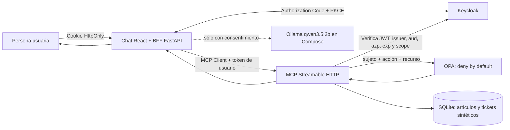

# PoC: chat de soporte seguro con agente y MCP

Implementación local de un chat conversacional de soporte de TI. Un agente acotado consulta artículos y tickets mediante herramientas MCP; Keycloak autentica a las personas y OPA decide si cada operación está permitida. Los datos son sintéticos.

## Informe técnico

El informe académico de la PoC sigue la estructura del documento de referencia e incluye riesgos OWASP, arquitectura, controles, escenarios y guion de demo: [docs/Informe-PoC-Seguridad-IA.docx](docs/Informe-PoC-Seguridad-IA.docx).

## Levantar el proyecto

Requisitos: Docker y Docker Compose.

```bash
cp .env.example .env
docker compose up --build
```

La primera ejecución compila el chat, descarga las imágenes y baja `qwen3.5:2b` (aprox. 2,7–3,1 GB). El modelo queda guardado en `ollama-data`; las siguientes ejecuciones lo reutilizan. El chat espera a que Ollama haya descargado el modelo. Cuando los servicios estén listos, abrí **http://localhost:8000** e iniciá sesión con uno de estos perfiles:

| Usuario | Contraseña | Perfil |
|---|---|---|
| `alice` | `alice-demo-pass` | Colaboradora; propietaria del ticket T-102 |
| `bob` | `bob-demo-pass` | Colaborador; propietario del ticket T-203 |
| `soporte` | `soporte-demo-pass` | Soporte L1; asignado a la cola `network` |

Keycloak importa el realm de demostración al iniciar. La consola local de Keycloak está en **http://localhost:8080** (`admin` / `local-only-admin-pass`). OPA y Ollama sólo están disponibles en la red interna de Compose; Ollama no publica un puerto en el host. El servidor MCP queda limitado a loopback en el puerto 8002 para facilitar la inspección local.

Para detener: `docker compose down`. Los tickets y el modelo se guardan en los volúmenes `support-data` y `ollama-data`; para borrar la base y el modelo descargado: `docker compose down -v`.

## Recorrido de la demo

Guion sugerido de 12–15 minutos. En el primer arranque, Compose descarga la imagen de Ollama y el modelo; esperá a que `ollama-model` termine antes de empezar.

### Preparación

```bash
cp .env.example .env
docker compose up -d --build
docker compose ps
```

Abrí **http://localhost:8000**. Los perfiles de demo son `alice` (`alice-demo-pass`), `bob` (`bob-demo-pass`) y `soporte` (`soporte-demo-pass`). Son usuarios sintéticos; no uses información real.

### Guion paso a paso

1. **Login y consentimiento del modelo — Alice.** Iniciá sesión como `alice`. En **Permisos de sesión**, habilitá el procesamiento con el modelo local. Explicá que ese permiso autoriza a Ollama a recibir el mensaje y los fragmentos que ya pasaron autorización; el token nunca se envía al modelo.
2. **Consulta de conocimiento — VPN.** Enviá “No puedo conectarme a la VPN desde Windows”. El chat presenta la tarjeta **Permiso de lectura**. Elegí **Autorizar y continuar**. La respuesta debe incluir fuentes como `KB-VPN-WIN`; pueden aparecer otros artículos relacionados. Mostrá que el consentimiento del modelo y el permiso para la herramienta son controles separados.
3. **Autorización por objeto — tickets.** Pedí consultar `T-102`, autorizá la herramienta de tickets y verificá que devuelve el caso propio de Alice. Luego preguntá por `T-203`, que pertenece a Bob. La respuesta debe ser la misma que para un ID inexistente y no revelar el contenido del ticket.
4. **Escritura con confirmación humana.** Enviá “Necesito abrir un ticket por problemas de conectividad”. Revisá la tarjeta **Revisá el ticket**: resumen y descripción son editables, y la cola de destino está fijada en soporte de red. Elegí **Cancelar** para terminar la demo sin escribir; o revisá y elegí **Confirmar creación** para demostrar la autorización final y la creación del ticket.
5. **Acceso por rol y asignación — soporte.** Cerrá sesión e iniciá como `soporte`. Consultá `T-203`: soporte L1 tiene acceso porque está asignado a `network`. También puede consultar los criterios internos de clasificación de la cola; Alice no puede ver ese artículo.
6. **Inyección en contenido no aprobado.** Como Alice o soporte, buscá el artículo en cuarentena o pedí información sobre “artículo en cuarentena”. No debe aparecer entre las fuentes: el artículo no está aprobado y se excluye antes de construir el contexto del modelo.
7. **Denegación ante caída de OPA — opcional.** Con la app activa, en otra terminal ejecutá `docker compose stop opa`, intentá una lectura y observá que falla cerrada. Restaurá el servicio con `docker compose start opa` antes de seguir.

Para observar decisiones MCP/OPA durante la demo:

```bash
docker compose logs --tail=50 mcp opa
```

Buscá `tool_invocation` y `tool_authorization`: aparecen sujeto, herramienta, recurso y decisión (`allow`/`deny`). Los logs no incluyen tokens, prompts ni descripciones de tickets.

### Puntos para explicar

- **Keycloak autentica** con OIDC Authorization Code + PKCE; el BFF guarda los tokens y el navegador sólo mantiene una cookie de sesión opaca.
- **El modelo propone; no autoriza.** El BFF valida las herramientas y argumentos permitidos. MCP vuelve a validar el Bearer token y consulta OPA para cada objeto; OPA deniega por defecto.
- **Lectura y escritura tienen barreras distintas.** Cada herramienta de lectura pide permiso de sesión; crear un ticket requiere revisar y confirmar una tarjeta. La confirmación está ligada a la persona y al contenido exacto.
- **Privacidad del modelo local.** Qwen corre en el contenedor Ollama de Compose. Sólo recibe la consulta y evidencia autorizada cuando se habilita el permiso del modelo. Si no hay permiso o Ollama falla, queda disponible la respuesta determinística local.
- **Falla cerrada.** Si OPA no responde, MCP no permite la operación. No hay autorización alternativa por rol ni fallback permisivo.

Los permisos pueden revocarse desde **Permisos de sesión** y se reinician al cerrar sesión. La prueba opcional de caída de OPA debe terminar con `docker compose start opa` para dejar el entorno listo.

## Arquitectura implementada



| Servicio | Responsabilidad |
|---|---|
| `chat` | Sirve la UI React y la API BFF. Mantiene tokens y consentimiento del lado servidor; resuelve intents, límites y confirmaciones. |
| `keycloak` | Realm `support-poc`, login OIDC, usuarios y roles sintéticos. |
| `mcp` | MCP SDK oficial para Python sobre Streamable HTTP; valida JWT y expone sólo tres herramientas tipadas. |
| `opa` | Punto de decisión de políticas. Se consulta en el punto de aplicación del servidor MCP para cada artículo, ticket y creación. |
| `ollama` / `ollama-model` | Ollama local sólo en la red interna; el servicio auxiliar descarga `LLM_MODEL` al volumen persistente antes de iniciar el chat. |
| `support-data` | SQLite compartida con FAQ aprobada, un artículo interno, un artículo en cuarentena y tickets sintéticos. |

## Autenticación, autorización y consentimiento

- El navegador inicia Authorization Code con PKCE S256. El BFF valida `state`, `nonce`, firma, `iss`, `aud`, expiración y que el `sub` del ID token coincida con el del access token. La cookie de sesión es opaca, `HttpOnly`, `SameSite=Lax` y `Secure` configurable para loopback; CSRF requiere token y validación de `Origin`.
- Los access y refresh tokens se guardan sólo en memoria del BFF, nunca en el navegador ni en `localStorage`. La sesión se pierde al reiniciar el contenedor y el despliegue usa una sola instancia de BFF.
- Keycloak no implementa el parámetro OAuth `resource` de RFC 8707. Por eso esta PoC agrega la audiencia `mcp-support` mediante un client scope de Keycloak y mapea explícitamente `sub`, roles y colas asignadas: el MCP exige `aud=mcp-support`, `azp=agent-bff`, firma/issuer/expiración válidos y `support:read`. Los tokens provistos a herramientas incluyen `support:write`, que la herramienta de escritura vuelve a comprobar. La UI nunca recibe esos tokens.
- El SDK MCP publica Protected Resource Metadata para `/mcp`. La adquisición de token ocurre en el login OIDC del BFF con audiencia configurada en Keycloak; no se implementa un cliente OAuth MCP independiente ni una solicitud RFC 8707 `resource` de punta a punta.
- El BFF bloquea la primera lectura de cada herramienta hasta obtener consentimiento de sesión. La UI explica qué consultará y permite revocar el permiso. La creación de tickets tiene una confirmación separada: el BFF firma una prueba HMAC, breve y ligada al usuario, al resumen, a la descripción y a un identificador idempotente. El MCP valida esa prueba y vuelve a pedir decisión a OPA.
- OPA recibe identidad y roles de claims validados, la acción y atributos del recurso leídos por el servidor. No confía en IDs de usuario, equipo, propietario, estado o cola enviados por el chat. Un error de OPA se interpreta como denegación.
- La auditoría del MCP registra sujeto, herramienta, recurso y decisión; no registra bearer tokens, prompts ni descripciones de tickets.

### Políticas incluidas

- Lectura de artículos públicos: `employee` y `support_l1`.
- Lectura de artículos internos: soporte L1 asignado a la cola correspondiente.
- Lectura de ticket: su propietario o soporte L1 asignado a la cola del ticket. La respuesta para ticket inexistente y ajeno es igual.
- Creación: colaborador o soporte L1, cola fija `network`, propietario derivado del token y confirmación firmada vigente.
- Toda decisión no cubierta por una regla se deniega.

## Agente y datos

El modelo configurado por defecto es `qwen3.5:2b`, descargado por Compose y persistido en `ollama-data`. La comunicación usa la interfaz local compatible con Chat Completions: `LLM_BASE_URL=http://ollama:11434/v1` y `LLM_API_KEY=ollama` (Ollama ignora esa clave). La UI pide consentimiento de modelo por sesión antes de enviarle la consulta. Para evitar que el canal de razonamiento consuma el límite de salida, las llamadas locales envían `reasoning_effort=none`; el timeout es de 60 segundos para dar margen a la inferencia en CPU. Si no hay consentimiento o Ollama falla, el agente responde con su ruta local determinística.

Qwen 3.5 2B soporta tool calling y `LLM_TOOL_CALLING_ENABLED=true`. Con consentimiento de modelo, puede proponer una sola acción de una lista fija. El BFF valida nombre y argumentos; las lecturas aún requieren consentimiento de herramienta y MCP/OPA autorizan cada recurso. Una propuesta de creación sólo prepara una tarjeta editable: la escritura requiere confirmación explícita y autorización nueva de OPA. El modelo no recibe tokens ni decide permisos.

Para elegir otro modelo, cambiá `LLM_MODEL` en `.env` y ejecutá `docker compose run --rm ollama-model`; luego reiniciá el chat con `docker compose up -d chat`. El modelo corre dentro del contenedor, así que su rendimiento depende de los recursos asignados a Docker.

La búsqueda del MVP es por palabras clave en SQLite, no usa embeddings ni un índice vectorial. Se excluyen registros no aprobados y se consulta OPA por cada artículo candidato antes de devolverlo. Un artículo de prueba con texto malicioso está en cuarentena.

## Controles OWASP que demuestra la PoC

La implementación acota el impacto de riesgos seleccionados; no afirma eliminar todos los riesgos de LLM, agentes o APIs.

| Riesgo | Control implementado / límite de la demo |
|---|---|
| LLM01 Prompt Injection | El modelo puede proponer una herramienta, pero el BFF valida una lista fija, esquema, consentimiento y argumentos; OPA vuelve a autorizar en MCP. Documentos son datos y las escrituras requieren confirmación. Se limita impacto, no se garantiza que un LLM nunca obedezca una inyección. |
| LLM02 Sensitive Information Disclosure | BOLA se resuelve en OPA sobre el objeto real; no se recupera ni entrega un ticket ajeno. Consentimiento antes del modelo externo. |
| LLM03 Excessive Agency | Sin shell, SQL genérico, HTTP arbitrario, administración ni cambio de roles. Escrituras mediante tarjeta de confirmación de un solo uso e idempotencia. |
| LLM04 Supply Chain | Versiones directas de Python/Node y versiones de imágenes fijadas; un único MCP confiable, sin carga ni descubrimiento dinámico. Para producción falta lock completo, escaneo y verificación de firmas/digests. |
| LLM05 Data and Model Poisoning | El artículo en cuarentena queda fuera de búsqueda; `approved` y metadatos se controlan en SQLite; el contenido no modifica las políticas. |
| LLM06 Unbounded Consumption | Mensaje máx. 1.200 caracteres, consultas acotadas, máximo 5 resultados, 20 mensajes/minuto por sesión, timeout de dependencias y límite de salida del modelo. Rate limit en memoria, sólo válido para instancia única. |
| LLM07 Misinformation | Respuesta a conocimiento cita artículos autorizados; si no hay evidencia, el agente lo reconoce y ofrece preparar un ticket. |
| LLM08 Hidden Context Exposure | Sin prompt del sistema secreto con credenciales, sin razonamiento oculto expuesto y sin tokens en el contexto del modelo. Errores de autenticación y servicios son genéricos. |
| LLM09 Vector and Embedding Weaknesses | Esta versión no usa vectores; por lo tanto no prueba aislamiento de un índice vectorial. Aplica autorización por artículo antes de construir evidencia. |
| LLM10 Improper Output Handling | No se ejecuta la salida del agente. React la representa como texto escapado; el servidor usa SQL parametrizado y payloads allowlist. |
| API1 BOLA / API5 BFLA | OPA comprueba propiedad/asignación del objeto en cada llamada MCP; rol no habilita herramientas fuera de política. |
| API2 Broken Authentication | OIDC Authorization Code + PKCE, `state`/`nonce`, firma/issuer/audiencia, sesión opaca, cookies HttpOnly y protección CSRF. |
| API3 Object Property Authorization | El cliente sólo puede enviar resumen/descripción; owner, ID, estado y cola se fijan en servidor. |
| API4/API6 Resource and Business Flow Abuse | Tamaño y frecuencia limitados; creación confirmada, payload firmado e idempotencia. No es un limitador distribuido ni antifraude de producción. |
| API7 SSRF | No existe herramienta para solicitar URLs; destinos de Keycloak, MCP, OPA y proveedor de modelo vienen de configuración del servidor. |
| API8 Misconfiguration | OPA sólo en red interna; puertos locales ligados a loopback; CORS no está habilitado; cabeceras CSP y anti-clickjacking. Keycloak `start-dev`, HTTP y secretos demo son exclusivamente para local. |
| API9 Inventory | Rutas implementadas explícitas, OpenAPI/docs deshabilitados, herramientas MCP fijas. |
| API10 Unsafe API Consumption | Respuestas externas tienen timeout; se valida firma JWT; la respuesta del proveedor se trata como texto y nunca se ejecuta. |

También se ejercitan casos acotados de Goal Hijack, Tool Misuse, Identity/Privilege Abuse y Context Poisoning del OWASP Top 10 for Agentic Applications. No hay memoria persistente del agente.

## Estructura

```text
backend/             BFF, login OIDC, agente y MCP client
mcp_server/          MCP resource server, validación JWT y herramientas
policies/support.rego políticas OPA deny-by-default
keycloak/            Realm importable y cuentas de demo
frontend/            Chat React + TypeScript
compose.yaml         Keycloak, OPA, MCP, chat y Ollama
```

## Límites de esta PoC

- Sólo loopback, cuentas/datos sintéticos y un realm Keycloak con `start-dev`. No usar en producción ni con tickets reales.
- La sesión y los consentimientos son memoria de una única instancia; no hay store distribuido, protección de sesión ante reinicio ni revocación centralizada inmediata de JWT ya emitidos.
- No se implementan consentimiento OAuth MCP automático, recurso RFC 8707, exchange de token, despliegue HTTPS, rotación de secretos, base de datos productiva, embeddings/vector DB, monitoreo central, retención de auditoría ni pruebas automatizadas adversariales.
- El permiso de herramienta lo aplica el BFF antes de llamar MCP. El resource server mantiene AuthN/AuthZ independiente, pero no conoce el estado de consentimiento UI por sí solo.

## Referencias

- [Documento base: Seguridad en Inteligencia Artificial](https://docs.google.com/document/d/1B5O8RHngPjX8MWVWJvreL8JFbL_Kigg0T02-btIVq1k/edit)
- [MCP Authorization y Protected Resource Metadata](https://modelcontextprotocol.io/specification/2026-07-28/basic/authorization)
- [SDK oficial MCP para Python: autorización de resource server](https://github.com/modelcontextprotocol/python-sdk/blob/main/docs/run/authorization.md)
- [Keycloak: Standard Token Exchange y alcance del parámetro `resource`](https://www.keycloak.org/securing-apps/token-exchange)
- [OPA: modelo de despliegue PDP/PEP](https://www.openpolicyagent.org/docs/deploy)
- [OWASP GenAI LLM Top 10 2026](https://genai.owasp.org/resource/owasp-genai-llm-top-10-2026/)
- [OWASP Top 10 for Agentic Applications 2026](https://genai.owasp.org/resource/owasp-top-10-for-agentic-applications-for-2026/)
- [OWASP API Security Top 10 2023](https://api-security.owasp.org/editions/2023/en/0x11-t10/)
